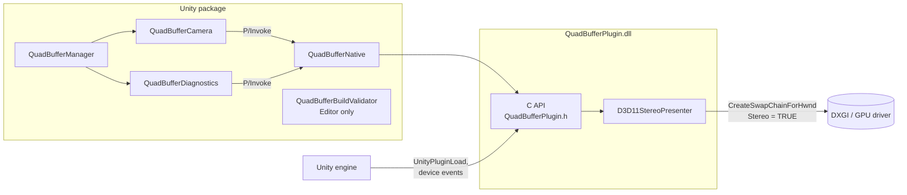
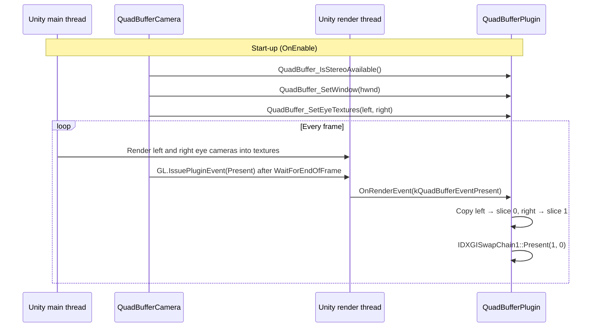

# Architecture overview

The system has two parts that ship together in the Unity package:

| Part | Language | Location | Responsibility |
|---|---|---|---|
| Managed layer | C# | `Packages/com.xra.quadbuffer/Runtime` | Renders each eye, owns render textures, drives the plugin every frame. |
| Native plugin | C++17 | `NativePlugin/` → `Runtime/Plugins/x86_64/QuadBufferPlugin.dll` | Owns the DXGI stereo swap chain and presents both eyes. |

Unity has no built-in quad-buffer output for non-XR displays, so presentation has to happen
outside Unity's own swap chain. See [ADR 0001](../adr/0001-native-dxgi-stereo-swap-chain.md).

## Components

- **QuadBufferManager**: one per scene. Finds or receives the stereo camera, adds the
  `QuadBufferCamera`, and drives the diagnostics every frame (runs before other scripts).
- **QuadBufferCamera**: MonoBehaviour on the stereo camera. Creates two child eye cameras and
  two render textures, and issues the present event at the end of each frame.
- **QuadBufferNative**: internal P/Invoke bindings, one per exported C function.
- **QuadBufferBuildValidator**: warns at build time if Windows is not set to Direct3D11 only.
- **QuadBufferDiagnostics**: runs only while a manager is registered; reads the plugin status every frame, logs each
  state change, and forwards native log messages. See [Status and logs](../manual/diagnostics.md).
- **QuadBufferConsole**: in-game overlay (F12) with the status and the log, added by the manager.
- **C API**: the exported functions, plus Unity's `UnityPluginLoad`/`UnityPluginUnload`.
- **D3D11StereoPresenter**: creates the stereo swap chain and copies the eyes into it.

## Frame flow

## Threading

| Call | Thread |
|---|---|
| `QuadBuffer_IsStereoAvailable`, `QuadBuffer_SetWindow`, `QuadBuffer_SetEyeTextures`, `QuadBuffer_GetStatus`, `QuadBuffer_PopLogMessage` | Main thread |
| Render event callback (`Present`, `PollStatus`) | Render thread |
| Plugin log messages | Any thread (queued under a lock) |
| Graphics device events (`Initialize`, `Shutdown`) | Render thread |

A mutex in `D3D11StereoPresenter` guards the state shared between the main and render threads.
Unity runs plugin events on the render thread in order with its own rendering, so the eye
textures are complete when `Present` copies them.

## Constraints

- **Direct3D11 only.** The plugin only binds when `IUnityGraphics::GetRenderer()` reports D3D11.
- **Driver stereo.** `IDXGIFactory2::IsWindowedStereoEnabled()` must return `TRUE`.
- **Matching textures.** `CopySubresourceRegion` needs eye textures that match the back buffer's
  size and a compatible format.

## Open issues

- The stereo swap chain shares Unity's window, which needs the flip model swap chain off
  ([ADR 0004](../adr/0004-share-unity-window-blit-model.md)). Not yet verified on stereo hardware.
- Eye textures are not recreated on resolution change.
